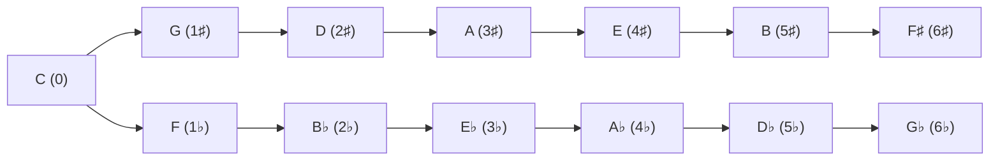

[Everything Else](misc.md) | [Guitar](guitar.md) | [Pan Flute](panflute.md) | [MusicTheory](musictheory.md) | [Scales](scales.md) | [Chord Progressions](chordprogressions.md) |
[Songs2Learn](songs2learn.md) | [MusicSoftware](musicsoftware.md)

# Keys

[Dmajor](dmajor.md)

- D E F# G A B C# D
- D F# A
- E G B
- F A C#
- G A B
- A C E
- B D F#
- C E G#

(The list above was my first attempt at the chords of D major, and several lines are wrong. The [D major](dmajor.md) page has the corrected chords: D, Em, F♯m, G, A, Bm, C♯dim.)

## The plain idea

A **key** tells you which seven of the twelve notes a piece mainly uses, and which one is home. The key of C major uses only the white keys of the piano. Every other major key uses the same *pattern* of steps (W W H W W W H) starting from a different note, and to keep that pattern it needs some sharps or flats. The list of those sharps or flats, written at the start of each line of sheet music, is the **key signature**.

## Why it matters

Keys let you move a song up or down to suit a voice or an instrument (**transposing**), and they explain why certain chords belong together. If you know the key, you know the seven chords a song is likely to use before you hear it.

## The circle of fifths

Start at C (no sharps). Go up a fifth (7 semitones) to G: one sharp. Up another fifth to D: two sharps. Keep going and you add a sharp each time. Going the other way, down a fifth (or up a fourth), you add flats: F has one flat, B♭ two.

F♯ major and G♭ major are the same notes spelled two ways, so the two arms meet and the line closes into a circle of twelve keys. Neighbours on the circle share six of their seven notes, which is why moving between them sounds smooth.

| Key | Sharps / flats | Relative minor |
|---|---|---|
| C | none | A minor |
| G | F♯ | E minor |
| D | F♯ C♯ | B minor |
| A | F♯ C♯ G♯ | F♯ minor |
| E | F♯ C♯ G♯ D♯ | C♯ minor |
| F | B♭ | D minor |
| B♭ | B♭ E♭ | G minor |

Memory aids: the sharps always appear in the order **F C G D A E B** ("Father Charles Goes Down And Ends Battle") and the flats in the reverse order **B E A D G C F**.

## An everyday analogy: the same tune in a different lift

Singing "Happy Birthday" starting on a higher note doesn't change the tune, just its height, like taking the same floor plan up a few floors in a lift. Keys are the floors. The pattern of rooms stays identical.

## A worked example: transposing with the capo

A song is in G (G–C–D–Em) but too low for your voice. Put a capo on the 2nd fret and play the same shapes. Each chord rises two semitones: G→A, C→D, D→E, Em→F♯m. You are now in A major without learning a single new shape. Mathematically you've added 2 to every note on the 12-note clock, exactly the clock arithmetic of [Groups](groups.md).

## Common misconceptions

- **"Sharp keys and flat keys sound different in character."** On modern equal-tempered instruments they have identical structure; differences come from instruments and associations.
- **"A song must stay in one key."** Many change key (modulate), often up a step for the final chorus.
- **"Minor keys have their own separate notes."** Each minor key shares its notes with a relative major; what changes is the home note.

## How it connects

- [Music Theory](musictheory.md), [D Major](dmajor.md), [Scales](scales.md), [Triads](triads.md)
- [The Alphabet](musicalalphabet.md): the fourths and fifths rows are the circle of fifths spelled out.

The truth revealed: twelve keys, one pattern. Learn the pattern and every key is just the same house on a different floor.
