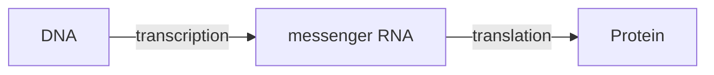

[Physics](physics.md) | [Biology](biology.md) | [Medicine](medicine.md) | [Chemistry](chemistry.md "MISSING PAGE") | [Climate](climate.md) | [Social](social.md "MISSING PAGE") | [Health](health.md) | [Philosophy](philosophy.md) | [Economics](economics.md) | [Politics](politics.md)
| [Ethics](ethics.md) | [Aesthetics](aesthetics.md "MISSING PAGE") | [Networks](networks.md)

# Biology

I can't say that I was ever really interested in Biology as a child. I always thought of it as a soft science more involved
with documenting taxonomies than anything else. In some sense that is how it was taught to me back in the day.

Boy how wrong had I been. It all dawned on me when I spent 4 days with
[Ellen Jorgensen](https://www.ted.com/speakers/ellen_jorgensen) @ [Genspace](https://www.genspace.org/) in Brooklyn,
New York.

It just opened my mind to the possibilities. I understood both the simplicity of the idea and the enormous complexity
of realising it practically. We are at the tip of the iceberg with this stuff and already this tiny tip has the power to
change the world.

The most important take away, for me at least, was the understanding that **Genetics**, is really firstly **Engineering**
and everything else second.
It is about tinkering, about real exploration of a world that is right with us, in us and around us,
not a distant star or galaxy somewhere in the Universe.

Unfortunately, I lost touch with the subject and didn't pursue it with the energy and dedication required to really make
use of it. I am always otherwise engaged, there is so much to learn in the world.

The following pages will be a documentation of where I have gotten with the subject. I hope that it will a guide to other
novices like me, who just don't know where to begin or what to exactly modern biology / genetics is all about.

I hope you enjoy it.

Adios,

{.center}

## Genetics

Most people like to think of **DNA** (and the genes they code) as a sort of **blueprint** for an organism. I think
its better to think of DNA as the **Operating System**. The cell is like the computer, it has
a living software, its DNA.

**Organisms** are colonies of closely related **Single Cells**.

{.center}

[Source](https://media.ccc.de/v/33c3-8369-machine_dreams#video&t=1566)

The **Genome** is like the **ROM (Read Only Memory)**, the **Epigenome** is like the **Flash Drive (i.e. State)**.

### The plain idea of genetics

Every living cell carries instructions written in **DNA**, a long molecule built from four chemical letters: A, C, G and T. A **gene** is a stretch of DNA that the cell reads to make something, usually a protein. The flow of information is often summarised as the "central dogma" of molecular biology:

The cell copies a gene into messenger RNA, and its ribosomes read the RNA three letters at a time (a **codon**), each codon calling for one of 20 amino acids. Chain the amino acids together and the chain folds into a protein: an enzyme, a hormone, a structural fibre, a pump. Proteins do almost all the work of life.

The human genome has about 3.1 billion letters, and the first truly complete, gap-free sequence was only published in 2022 by the Telomere-to-Telomere consortium. Surprisingly, only around 20,000 genes code for proteins, about 1–2% of the DNA. Much of the rest is regulation: switches deciding which genes are on in which cell at which time. That is why a liver cell and a neuron, with identical DNA, are so different.

### Why it matters

Biology is the science of the most complex things we know of, and in the 21st century it has become, as I found out at Genspace, an engineering discipline:

- **Reading DNA** got absurdly cheap. Sequencing the first human genome cost around \$3 billion and took 13 years; today a whole genome can be read for a few hundred dollars in about a day.
- **Writing and editing DNA**: CRISPR-Cas9, adapted as an editing tool by Jennifer Doudna and Emmanuelle Charpentier (Nobel Prize in Chemistry 2020), lets scientists cut DNA at a chosen spot. In December 2023 the first CRISPR-based medicine, Casgevy, was approved in the US for sickle-cell disease, and newer techniques such as base editing and prime editing change single letters without cutting both strands.
- **Predicting proteins**: AlphaFold (Nobel Prize in Chemistry 2024) predicts a protein's 3D shape from its sequence, a problem that had resisted 50 years of work.
- **mRNA vaccines**, which deliver a gene's RNA so your own cells make a harmless piece of a virus, earned the 2023 Nobel Prize in Medicine.

### An everyday analogy: the recipe book and the kitchen

I like the operating-system analogy above. Another useful one: the genome is a giant recipe book, every cell has a full copy, and the epigenome is the set of bookmarks and sticky notes saying which recipes this particular kitchen cooks. A muscle cell's bookmarks open the muscle recipes; a skin cell's open the skin recipes. Change the sticky notes and you change the cell, without touching a word of the book. Epigenetic marks such as DNA methylation also drift with age in measurable ways, which is how "epigenetic clocks" like the Horvath clock estimate biological age.

### A worked example: reading a gene

Take the DNA coding sequence `ATG GGA TTC TAA`.

1. Transcribe to RNA (T becomes U): `AUG GGA UUC UAA`.
2. Translate with the genetic code: `AUG` = methionine (and "start"), `GGA` = glycine, `UUC` = phenylalanine, `UAA` = "stop".
3. Result: a tiny peptide, Met–Gly–Phe.

Now change one letter, `TTC` to `TGC`: the RNA codon becomes `UGC`, cysteine instead of phenylalanine. One letter, one different amino acid. In sickle-cell disease, a single-letter change in the beta-globin gene swaps glutamic acid for valine, and that alone makes red blood cells deform into sickles. Small typos, big consequences, which is exactly why precise editing is so powerful.

### Evolution: the idea that makes sense of it all

The geneticist Theodosius Dobzhansky wrote in 1973 that "nothing in biology makes sense except in the light of evolution." Copying DNA is extremely accurate but not perfect; variations arise; those that help an organism survive and reproduce in its environment become more common. Over billions of years that simple loop produced every species on Earth, all sharing the same genetic code, which is the strongest evidence that all life has a common ancestor.

### Common misconceptions

- **"There's a gene for X."** Most traits, from height to disease risk, are influenced by hundreds or thousands of genes plus environment.
- **"Junk DNA is useless."** Some is genuinely non-functional, but much non-coding DNA regulates genes.
- **"Genes are destiny."** Gene expression responds to diet, stress, exercise and age.
- **"Organisms evolve because they need to."** Evolution has no foresight; variation is random, selection is not. See [Teleology](teleology.md).

### How it connects

- [Anatomy](anatomy.md) for the body's structure.
- [Design in Nature](designinnature.md) and [Teleology](teleology.md) for purpose without a designer.
- [Science](science.md) for the method.

The truth revealed: life runs on a four-letter code that we can now read, write and edit, and we are still learning what most of it says.

#### Some links:

- [A Crack in Creation by Jennifer Doudna & Samuel Sternberg](acrackincreation.md) is a really wonderful
  book that will get you up to date on the engineering and technology at hand today.
- [What you need to know about CRISPR, a TED talk by Ellen Jorgensen](https://www.ted.com/talks/ellen_jorgensen_what_you_need_to_know_about_crispr)
- [the-horvath-clock](https://towardsdatascience.com/examining-the-horvath-clock-and-the-significance-of-biological-age-a5d64b73bc44)

## [Medicine](medicine.md)
