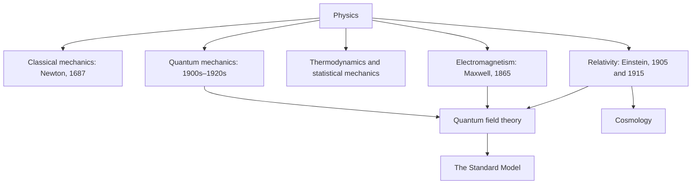

[Physics](physics.md) | [Biology](biology.md) | [Chemistry](chemistry.md "MISSING PAGE") | [Climate](climate.md) | [Social](social.md "MISSING PAGE") | [Health](health.md) | [Philosophy](philosophy.md) | [Economics](economics.md) | [Politics](politics.md)
| [Ethics](ethics.md) | [Aesthetics](aesthetics.md "MISSING PAGE") | [Networks](networks.md) | [Energy](energy.md) | [Electromagnetic Theory](electromagnetictheory.md)

{.center}

# viKid Physics

The subject of physics is absolutely massive and even this Superhero isn't terribly sure quite just
how to present it. Frankly, I am entirely confused by the subject myself.
At any case I have put down the skeleton of what I think want to write about. It is subject to
massive change. So if you like something, download or print it. It may not be here (in the same
incarnation) the next time you visit.

## The plain idea

Physics is the attempt to find the **smallest set of rules that explains the largest number of things**. Why does an apple fall, why does the Moon not fall, why is the sky blue, why do stars shine, why does ice float? Physics answers them all with a handful of principles and a lot of mathematics. It is the most fundamental of the natural sciences: chemistry is physics of electrons in atoms, and biology is chemistry that copies itself.

## Why it matters

Every technology you depend on is applied physics: electricity, engines, radio, lasers, satellites, MRI scanners, the transistors in your phone (which work by quantum mechanics), the GPS that has to correct for both special and general relativity to stay accurate to within metres. And physics changes how we see ourselves. It told us the Earth is not the centre, that time runs at different rates for different observers, and that matter is mostly empty space filled with fields.

## The map of physics

- **Classical mechanics** – forces and motion, \(F = ma\). Still how we build bridges and fly rockets.
- **Electromagnetism** – charges, fields and light. See [Electromagnetic Theory](electromagnetictheory.md).
- **Thermodynamics** – heat, [energy](energy.md) and entropy; why time seems to have a direction.
- **Relativity** – space and time are woven together; gravity is the curvature of spacetime. See [Relativity](relativity.md).
- **Quantum mechanics** – the rules of the very small, where things come in discrete packets and outcomes are probabilistic. See [Quantum Mechanics](qm.md).
- **The Standard Model** – the particles and three of the four forces. See [The Standard Model](standardmodel.md).

## An everyday analogy: the zoom lens

Physics is a camera with a zoom. Zoom out to planets and Newton's laws are perfect. Zoom to things moving near light speed, or to very strong gravity, and you need relativity. Zoom into atoms and you need quantum mechanics. Each theory is excellent at its own magnification. The big unfinished job is a single lens that works at every zoom, in particular one that unites gravity with quantum mechanics.

## A worked example: why the Moon doesn't fall (actually, it does)

Newton's insight was that the Moon *is* falling toward the Earth, all the time; it is just moving sideways fast enough to keep missing. Check it with numbers. The Moon is about \(r = 3.84 \times 10^8\) m away and goes round once every 27.3 days (\(T \approx 2.36 \times 10^6\) s). Its centripetal acceleration is

$$ a = \frac{4\pi^2 r}{T^2} \approx \frac{4\pi^2 \times 3.84 \times 10^8}{(2.36 \times 10^6)^2} \approx 0.0027\ \text{m/s}^2 $$

If gravity weakens as \(1/r^2\), then at 60 Earth radii it should be \(9.8 / 60^2 \approx 0.0027\ \text{m/s}^2\). The same force that drops the apple holds the Moon. That one calculation unified heaven and earth.

## The frontier today

Physics is far from finished. The biggest open questions: what **dark matter** is (it outweighs ordinary matter about five to one, yet decades of detector searches have found nothing); what **dark energy** is, with recent results from the DESI survey hinting that it may change over time; how to reconcile **gravity with quantum mechanics** (string theory and loop quantum gravity remain unconfirmed); and why the universe has more matter than antimatter. Meanwhile gravitational-wave observatories, first successful in 2015, now detect colliding black holes routinely, and quantum computers are turning quantum mechanics from a puzzle into a technology.

## Common misconceptions

- **"Physics has found the final laws."** The [Laws of Physics](thelawsofphysics.md) are our best current models; dark matter, dark energy and quantum gravity remain open.
- **"Quantum means anything goes."** Quantum mechanics is extremely precise; it predicts probabilities exactly.
- **"Heavier things fall faster."** Without air resistance, all objects fall at the same rate, as Galileo argued and astronauts demonstrated on the Moon with a hammer and a feather.

The truth revealed: a few rules, written in mathematics, explain the fall of an apple and the shine of a star. Below is my skeleton of the subject.

- [Philosophy in Physics](philosophyinphysics.md)
- **[metaphysics](metaphysics.md "MISSING PAGE")**
- **'is the case or what is there'.**
- [Click here to find out more about Philosophy in Physics](philosophyinphysics.md)
- [Classical Mechanics / Classical Physics](classicalmech.md "MISSING PAGE")
- **certainly**
- **absolute**
- [Click here to find out more on: Classical Mechanics / Physics](classicalmech.md "MISSING PAGE")
- [Quantum Mechanics/ Quantum Physics](qm.md)
- [Design in Nature](designinnature.md)
- [Standard Model](standardmodel.md)
- [The Laws of Physics](thelawsofphysics.md)
- **There are no laws of Physics**
- *measurement is impossible*
- **reality**
- **rules of interaction**
- **laws**
- [The Structured Atom Model](structeredatom.md "MISSING PAGE")
- [Electromagnetic Theory](electromagnetictheory.md)
